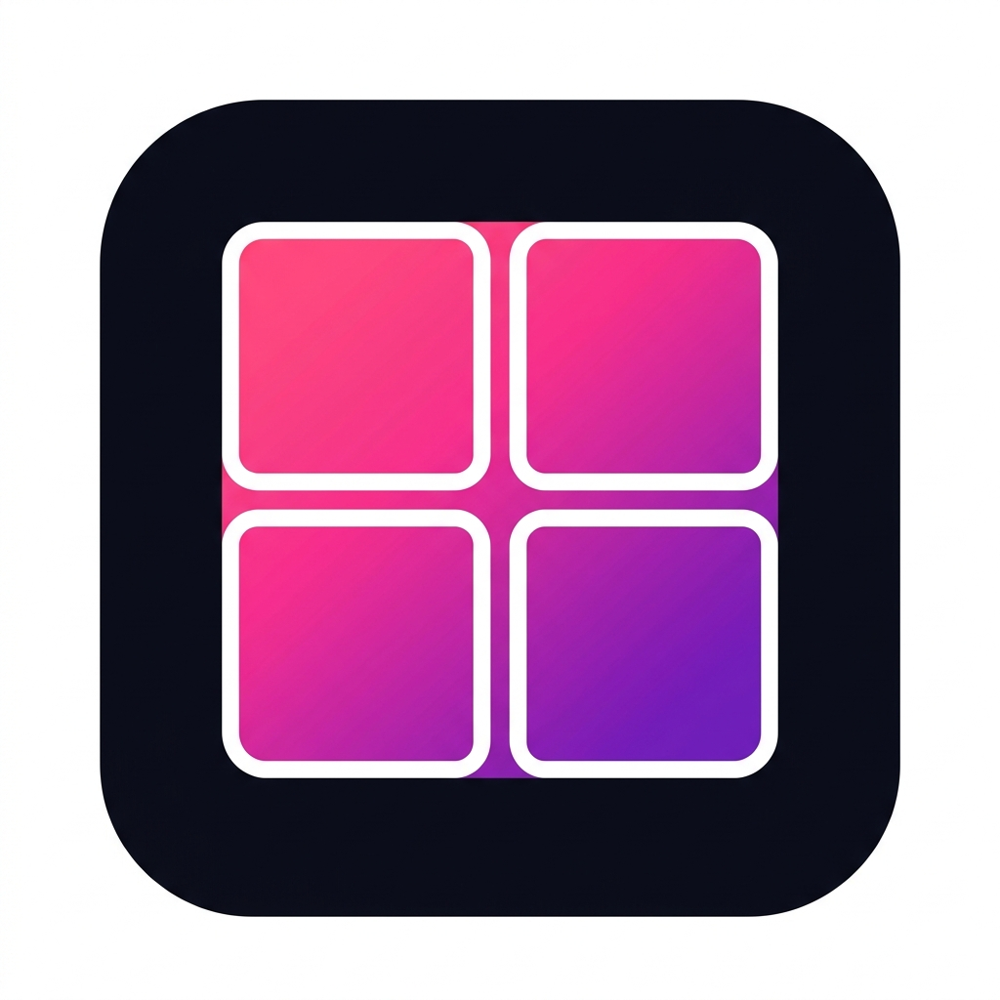

  

# PicCollage for Android

**A high-performance, native Android collage studio built with Jetpack Compose.**

PicCollage is designed for speed, precision, and aesthetic control. Unlike many collage apps that rely on heavy external libraries, this app uses a custom-built rendering engine to deliver high-resolution exports and a butter-smooth UI optimized specifically for Android phone devices.

  

## ✨ Premium Features

- **🎨 50 Dynamic Gradient Borders:** A massive library of Neon, Cyberpunk, Holographic, Luxury Metallics, Pastels, Botanicals, and Conical Sweep gradients.
- **🎄 12 Procedural Holiday Borders:** Vector-drawn Candy Cane stripes, Snowy Pine snowflakes & holly, Spooky Night crescent moons & bats, Valentine hearts, St. Patrick's shamrocks, Easter Egg patterns, 4th of July stars, Thanksgiving tartan plaid, Hanukkah Stars of David, and New Year's glam confetti.
- **📐 11 Pro Layouts + Custom Grid Builder:** Includes `3×3` grid plus a custom builder where you choose rows & columns and drag the divider lines.
- **📲 Flexible Aspect Ratios:** Square (`1:1`), Portrait (`4:5`, `3:4`, `2:3`), Story (`9:16`), Landscape (`5:4`, `4:3`, `3:2`), Wide (`16:9`), or any Custom `W:H` ratio.
- **🖼️ Slot-Based Photo Management:** Pinch-to-zoom, pan, rotate 90°, or remove individual photos directly in the live preview.
- **🌈 Advanced Color & Corner Control:** Full-spectrum HSV color picker, border thickness slider (`0–40px`), and photo corner radius slider (`0` = square corners).
- **💾 Multi-Resolution Export:** Standard (`1080p`), High (`1440p`), and Ultra (`2160p`) crisp JPEG output saved directly to your Gallery.

## 📱 Specifications
- **Package ID:** `com.tailgunnerx.piccollage`
- **License:** [Apache License 2.0](LICENSE)
- **OS:** Android 8.0+ (API 26+)
- **Device Type:** Optimized for Android Phones (Portrait Mode)

## 🔒 Privacy & Transparency
- **Zero Tracking:** No Firebase, no analytics, no crashlytics.
- **No Internet Required:** The app works 100% offline. No internet permission is requested.
- **No Ads:** Pure, uninterrupted creative experience.

## 🛠️ Tech Stack
- **Language:** Kotlin
- **UI Framework:** Jetpack Compose (Material 3)
- **Rendering:** Custom `CollageRenderer` using Android `Canvas` and `Shader` APIs.

## 🚀 Getting Started

1. **Clone the Repo:** `git clone https://github.com/tailgunnerx/PicCollage-Android.git`
2. **Open in Android Studio:** Select the root project folder.
3. **Build & Run:** Deploy to your physical device or emulator.

---
*Created with focus on Rich Aesthetics and High Performance.*
